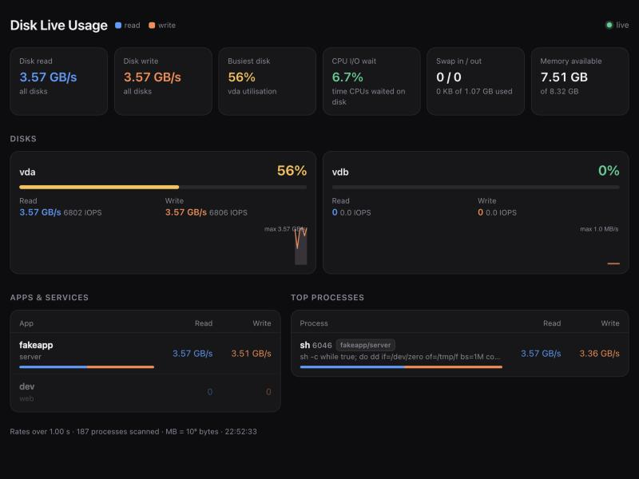

# Homelab: a Community App Store for umbrelOS

A personal store with two apps:

| App | What it does |
|---|---|
| [Disk Live Usage](#disk-live-usage) (`homelab-disk-live-usage`) | Live Usage for disks: who reads and writes to the disk |
| [Kinoseed](#kinoseed) (`homelab-kinoseed`) | A qBittorrent web UI built around movies and TV series |

To add the store to umbrelOS, see [Install in umbrelOS](#install-in-umbrelos).

## Disk Live Usage

Like umbrelOS's built-in Live Usage (CPU and RAM per app), but for disks.
It shows in real time (every second, over SSE) **who exactly** is reading and writing to the disk:

| Block | Source | What you see |
|---|---|---|
| Disks | `/proc/diskstats` | read/write MB/s, IOPS, utilisation % (io_ticks) |
| Apps | cgroup v2 `io.stat` + Docker API | MB/s per Umbrel app (containers grouped by `<app-id>_<service>_1`) |
| Host services | `system.slice/*.service/io.stat` | `umbrel` (umbreld), `docker`, `containerd`… only while they are doing something |
| Processes | `/proc/<pid>/io` | top 15 host processes, labelled with their app or systemd unit |
| Summary | `/proc/stat`, `/proc/vmstat`, `/proc/meminfo` | CPU iowait, swap in/out, swap used, memory available |

The last block is why this exists: on a Raspberry Pi the biggest disk consumer turned out to be
`umbreld` (the umbrelOS file indexer, `node /opt/umbreld`), which is not a container, so `docker stats` doesn't show it.



## Layout

```
umbrel-app-store.yml              id: homelab, the prefix for every app in this store
homelab-kinoseed/
  umbrel-app.yml                  Kinoseed manifest (port 8795 on Umbrel)
  docker-compose.yml              app_proxy + web service (image built in the Kinoseed repository)
  icon.svg                        app icon
  data/                           copied to the app's data folder, where Kinoseed keeps its settings
homelab-disk-live-usage/
  umbrel-app.yml                  manifest (port 7841 on Umbrel)
  docker-compose.yml              app_proxy + web service
  Dockerfile                      Go → static binary in scratch (~8–11 MB image)
  *.go, web/index.html            collector and UI (Go standard library only, no JS dependencies)
dev/docker-compose.yml            local run without umbrelOS
.github/workflows/docker.yml      builds the arm64+amd64 image into GHCR on a v* tag
```

The collector is light: one pass over `/proc` and cgroupfs per tick, no external commands, and the container list
from the Docker API refreshes every 5 s. **It only polls while the page is open** (or something calls
`/api/snapshot`): close the tab and the app does nothing. On a Mac (Docker Desktop) under load: ~0.1 % CPU, 6.4 MiB RAM;
not measured on a Pi yet, expected around 1–2 % of one core.

## ⚠️ Security: why this is for a personal store, not the official one

To see host processes and map cgroups to apps, the container runs with:

- `pid: host`: it sees every Umbrel process and its command line (which can contain passwords or tokens in arguments);
- `cap_add: SYS_PTRACE, DAC_READ_SEARCH` and `apparmor:unconfined`: needed for the kernel to allow reading `/proc/<pid>/io`
  of other users' root processes (umbreld). Together with `pid: host` this makes it technically possible to attach (ptrace) to any host process;
- `/var/run/docker.sock:ro`: **`:ro` on the socket protects nothing**. The socket lets you not only read but also start
  containers with any privileges. The app makes exactly one request, `GET /containers/json`, but socket access itself means root on the host.

In short: **the app is equivalent to root access to your Umbrel**. Mitigations: `cap_drop: ALL` (only the two needed
capabilities are added back), `read_only: true`, `no-new-privileges`, `mem_limit: 64m`, a `scratch` image without a shell, no outgoing
connections, host paths mounted read-only and nothing written. The UI is behind Umbrel's login through `app_proxy`.
The code is short (~800 lines of Go), so you can read all of it before installing. The official Umbrel App Store would most
likely not accept an app like this; it is meant for a personal community store.

To reduce the risk, run [docker-socket-proxy](https://github.com/Tecnativa/docker-socket-proxy) next to it with `CONTAINERS=1`
and set `DOCKER_HOST=tcp://homelab-disk-live-usage_docker_proxy_1:2375`: the service can reach Docker over TCP too.
Without the socket at all, only app names disappear (disks and processes stay).

### Publishing the image

Image: `ghcr.io/mrshakhov/umbrel-disk-live-usage` (linux/arm64 + linux/amd64). GitHub Actions
([.github/workflows/docker.yml](.github/workflows/docker.yml)) builds it when a `v*` tag is pushed:

```bash
git tag v0.1.1 && git push origin v0.1.1   # → ghcr.io/mrshakhov/umbrel-disk-live-usage:0.1.1
```

New release: bump `version` in `umbrel-app.yml` and the image tag in `docker-compose.yml`, commit, push,
and push a tag with the same number. The GHCR package must be **public**
(GitHub → Packages → umbrel-disk-live-usage → Package settings → Change visibility → Public), or Umbrel can't pull the image.

### Running locally (Mac/Linux with Docker)

```bash
docker compose -f dev/docker-compose.yml up --build
```

UI: <http://localhost:8080>, JSON: `curl localhost:8080/api/snapshot`.

On a Mac it works but shows **the Docker Desktop virtual machine**, not the Mac itself: disks `vda/vdb`,
the VM's `dockerd`/`containerd` processes, Docker Desktop's containers. There are no systemd services, so no "host" rows.

### Reading the numbers, known limits

- MB = 10⁶ bytes. 100 % utilisation on an HDD means the queue isn't draining.
- `/proc/<pid>/io` counts real disk access: reads from the page cache aren't counted, and writes are counted when
  the page is dirtied, so a process's write peak can run a few seconds ahead of the disk (writeback).
- The kernel adds the I/O of finished child processes to their parent, so short `dd`/`ffmpeg` runs show up under their parent.
- cgroup `io.stat` also counts deferred writes, so the per-app total is closer to the disk numbers than the per-process total.
- **Not tested on a real Umbrel.** It expects cgroup v2 with Docker's systemd driver (`system.slice/docker-<id>.scope`);
  `docker/<id>` is supported too. If yellow notes appear at the bottom of the page, they say what is missing
  (no io.stat, Docker API unreachable, N processes unreadable because of AppArmor or permissions, and so on).

### Settings (env in docker-compose.yml)

| Variable | Default | |
|---|---|---|
| `INTERVAL` | `1s` | polling interval (at least 250ms) |
| `TOP_PROCS` | `15` | how many processes to show |
| `DOCKER_HOST` | `unix:///var/run/docker.sock` | or `tcp://host:port` |
| `CGROUP_ROOT` | `/host/cgroup` | where the host's `/sys/fs/cgroup` is mounted |
| `PROC_ROOT`, `SYS_ROOT` | `/proc`, `/sys` | |
| `LISTEN` | `:8080` | |

## Kinoseed

A qBittorrent web UI built around movies and TV series: search TMDB, pick a release found by Prowlarr,
send it to qBittorrent and follow your downloads. Installable on your phone as an app (PWA).

- **Dependencies:** the **qBittorrent** and **Prowlarr** apps from the Umbrel App Store. Umbrel won't install Kinoseed without them.
- **qBittorrent:** Kinoseed finds it on its own and signs in with Umbrel's default login `admin`/`adminadmin`. If the login was changed,
  Kinoseed asks for it once and keeps it.
- **Prowlarr:** the API key is read from Prowlarr's `config.xml`. Its `config` folder is mounted read-only.
- **TMDB:** on first launch Kinoseed asks for a free [TMDB API key](https://www.themoviedb.org/settings/api)
  and keeps it on your Umbrel, in the app's data folder.
- The UI is behind Umbrel's login through `app_proxy`.

Image: `ghcr.io/mrshakhov/kinoseed` (linux/arm64 + linux/amd64), published by the Kinoseed repository's Release workflow
on a `v*` tag. `docker-compose.yml` pins it by tag and digest.

New release: in `homelab-kinoseed/`, bump `version` and `releaseNotes` in `umbrel-app.yml` and the image tag and digest
in `docker-compose.yml` (the digest is in the GitHub Release), then commit and push. Umbrel offers the update.

## Install in umbrelOS

1. Open **App Store** → the **⋯** menu at the top right → **Community App Stores**.
2. Paste the repository URL (`https://github.com/MrShakhov/umbrel-homelab-store`) → **Add**.
3. Open the new **Homelab App Store** → **Disk Live Usage** or **Kinoseed** → **Install**.
4. Disk Live Usage opens at `http://umbrel.local:7841`, Kinoseed at `http://umbrel.local:8795`.

After a new release (see above) Umbrel offers the update on its own.

To rename the store, change `id` in `umbrel-app-store.yml`, the app folder names, `id` in each manifest and `APP_HOST`
in each compose file: all of them must share the prefix.
